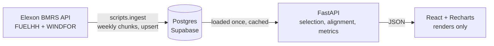

# Wind forecast accuracy portal

A day-ahead trader at a UK supplier decides on D-1 how much gas power to buy for each
half hour of day D, and wind is the swing factor. This app shows the trader the wind
forecast they could actually have used: the latest Elexon WINDFOR publish before the
decision cut-off, never a later revision. It then quantifies how wrong that forecast
tends to be, so the purchase can carry a measured risk buffer instead of a guess. Scope
is GB national wind for delivery days in January 2026, with Elexon FUELHH as the actuals.

**What January says:** at the 09:00 cut-off the forecast ran **1,852 MW high on
average** (MAE 2,142 MW, nMAE 18.5%, n = 744 hours), so a buyer trusting it starts most
days short. It still beats a "tomorrow looks like today" baseline, with a skill score of
0.49. Deciding at 11:00 instead of 09:00 picks up a fresher publish but only cuts MAE by
23 MW on the same hours. The bias is the bigger lever.

## Live links

| | |
|---|---|
| Frontend (Vercel) | https://skcirb-web.vercel.app |
| API (Render) | https://skcirb-api.onrender.com/api/health |
| API docs | https://skcirb-api.onrender.com/docs |

The API runs on Render's free plan, which sleeps when idle. The first request after a
quiet spell takes about a minute.

## Files and directories

```
.
├── README.md
├── CLAUDE.md               rules for AI-assisted sessions on this repo
├── docker-compose.yml      db + backend + frontend, one command
├── render.yaml             Render blueprint for the API
├── .env.example            every config variable; no secrets
├── specs/                  product and engineering specs, the source of truth
├── docs/                   ASSUMPTIONS (numbered, dated), ARCHITECTURE, PHASES
├── backend/
│   ├── app/
│   │   ├── core/           the logic that matters: periods, selection, alignment, metrics
│   │   ├── ingest/         Elexon client and loader: fetch, normalise, upsert
│   │   ├── routers/        FastAPI endpoints
│   │   ├── analysis.py     picks which rows feed each endpoint (no maths)
│   │   ├── data.py         in-memory cache of the closed study month
│   │   └── models.py, schemas.py, config.py, db.py, main.py
│   ├── scripts/            ingest CLI, idempotency counts, hand verification
│   └── tests/              pytest suite plus raw one-day Elexon fixtures
└── frontend/
    └── src/
        ├── api/client.ts   every fetch call, in one place
        ├── pages/          Day view, Accuracy, Periods
        └── components/     charts, stat cards, metric table
```

## How to start

```bash
cp .env.example .env
docker compose up --build
# frontend http://localhost:3000, API docs http://localhost:8000/docs
docker compose exec backend python -m scripts.ingest --from 2025-12-30 --to 2026-02-01
```

The default `.env` points the backend at the local Postgres container. To use Supabase
instead, set `DATABASE_URL` to its Session pooler URI with `?sslmode=require`; nothing
else changes. SQLite works too through the same variable.

Tests run offline:

```bash
cd backend
python -m venv .venv && .venv/Scripts/pip install -r requirements-dev.txt   # bin/ on macOS/Linux
.venv/Scripts/python -m pytest -v
```

## Architecture



One data path, and all logic is server-side. React renders what the API returns.
Details are in [docs/ARCHITECTURE.md](docs/ARCHITECTURE.md). Django was not used: there is
no auth, admin or user writes, so its ORM and admin would be unused weight on a
read-only analytics API. Supabase is used as plain Postgres only.

## Key assumptions

Every assumption is numbered and dated in [docs/ASSUMPTIONS.md](docs/ASSUMPTIONS.md).
The ones that shape the numbers:

- **Cut-off is 09:00 UTC on D-1 by default.** GB day-ahead auctions close mid-morning
  on D-1, and EPEX and N2EX differ slightly. 09:00 is deliberately conservative and
  should be confirmed with the client. It is an env var (`DECISION_CUTOFF_HOUR_UTC`)
  and a selector in the UI.
- **UTC equals UK local time** for the whole window. January has no BST, which also
  avoids the 46- and 50-period clock-change days. The code refuses non-GMT days rather
  than guessing.
- **National level only, January 2026 only.**
- **WINDFOR is hourly; settlement periods are half-hourly.** Metrics run on an hourly
  frame: the two half-hour actuals are averaged and compared with the one hourly
  forecast, so n = 744, not a doubled 1,488. The 48-period chart holds each hourly
  forecast across both periods and says so on screen.
- **The horizon chart uses all forecast vintages.** Every other figure uses only the
  decision-time forecast.
- **Missing forecasts are gaps, never zero.** Cut-offs from 00:00 to 02:00 genuinely
  have no forecast for 22:00 and 23:00.

## Metric definitions

Copied from SPEC-1 §4. All metrics run on the hourly frame. For N paired hours,
`f` = forecast MW and `a` = actual MW (the mean of the hour's two half-hours):

| Metric | Formula | Unit | How to read it |
|---|---|---|---|
| Error | `e = f − a` | MW | Positive = forecast over-predicted wind |
| **ME (Bias)** | `mean(e)` | MW | Systematic lean. Non-zero bias is correctable |
| **MAE** | `mean(abs(e))` | MW | Typical miss size |
| **RMSE** | `sqrt(mean(e²))` | MW | Like MAE but punishes large misses. RMSE >> MAE means occasional big failures |
| **nMAE** | `MAE / mean(a)` | % | MAE as a share of average actual wind |
| **P5 / P50 / P95 of e** | quantiles (linear) | MW | The risk band |
| **Max absolute error** | `max(abs(e))` | MW | Worst case, with its timestamp |
| **Energy error** | `sum(e) × 1 h` | MWh | Cumulative over/under procurement |
| **Skill score** | `1 − RMSE / RMSE_persistence` | – | Persistence: `actual(D − 1 day, same hour)`. Above 0 beats it |

MAPE is deliberately not a headline. It explodes when actual wind is near zero on calm
nights, so nMAE is the headline percentage.

## Testing

`pytest -v` runs 59 tests in about 10 seconds with no network access. Fixtures are raw
one-day Elexon responses saved during recon, plus small synthetic frames.

- **Selection:** the cut-off is never crossed and the latest qualifying publish wins.
  A missing hour is None, not 0 and not a later publish. Includes the real
  15 January late publish (the 11:30 slot appeared at 12:25) and the real 01:00 cut-off
  gap at 22:00–23:00.
- **Metrics:** hand-computed MAE, RMSE, bias and quantiles to 6 decimal places;
  perfect-forecast and null handling; n = 744; metrics refuse step-expanded data.
- **Alignment and periods:** hourly averaging, 48-period expansion, SP and timestamp
  round-trips, refusal of non-GMT days.
- **Ingest:** WIND-only filter, negative-MW rule, the exclusive upper bound,
  idempotent upserts, HTTP and database retries.
- **API:** range errors, `cutoff_hour` and `n_observations` on every response, CSV blanks.

`python -m scripts.hand_verify 2026-01-12` recomputes one day's MAE and RMSE with raw
SQL and plain arithmetic, and matches `metrics.py` to 6 dp. Not covered: React
components and live Elexon calls; the frontend is verified by screenshots instead.

## AI tool disclosure

This project was built with **Claude Code** (Anthropic's coding agent) as a pair
programmer. It wrote most of the code, tests, ingest scripts and these docs, ran the
recon against the live Elexon API, and ran the ingests and deploys. The product and
scope decisions were made by me after reviewing its findings: hourly versus half-hourly
handling, all-vintage horizons, storing past-hour rows, WIND-only actuals, accepting the
ingest runtime, and Render instead of Heroku. These are recorded as decisions D1–D13 in
`docs/ASSUMPTIONS.md`. I reviewed the outputs, screenshots and figures throughout.

## Known limitations and next steps

- **One month of data**, national level only. National figures mask regional error.
- **No price data**, so error is not converted into £. The next step would be to
  monetise it with day-ahead and imbalance prices.
- **No automated refresh.** Ingest is a one-shot command for a closed month. A
  scheduled refresh is the obvious next step.
- **Point forecast only.** Probabilistic forecasts would replace the empirical
  P5–P95 band.
- **The bias is large and unexplained.** One plausible cause is that the forecast
  reflects unconstrained output while metered outturn reflects curtailment. That is a
  hypothesis, not verified.
- **Ingest runtime:** a full ingest takes 2–2.5 minutes (measured 122–154 s) because
  the Supabase project is in Tokyo. The time is network-bound, not code-bound; an
  EU-region database would likely bring it under 2 minutes.
- **Hosting:** the API is on Render's free plan instead of Heroku, which no longer has
  a free tier. It sleeps when idle.
- Commit timestamps span about 22 hours of wall-clock time, including an overnight break.
