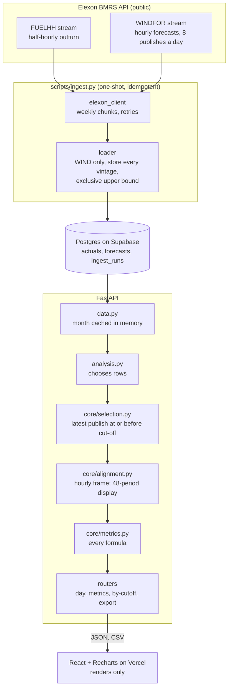

# Architecture

## Data flow

1. **Ingest.** `scripts/ingest.py` pulls everything published in
   `[2025-12-30T00:00Z, 2026-02-02T00:00Z)` in weekly chunks.
   - Actuals: keeps FUELHH rows with `fuelType = "WIND"` and rejects negative WIND MW.
   - Forecasts: stores every WINDFOR row, including past-hour rows, with
     `horizon_hours` computed at write time.
   - Writes are upserts on the primary keys inside one transaction, so a rerun changes
     nothing.
2. **Load.** The API reads the closed month once and caches it for 10 minutes. The
   whole dataset is about 20k forecast rows.
3. **Select.** For each delivery day D and hour H, `select_for_day` keeps the latest
   publish with `publish_time <= cutoff(D)` and `horizon_hours >= 0`. If nothing
   qualifies, the hour is missing, never 0 and never a later publish.
4. **Align.** `to_hourly` averages the two half-hour actuals. `hourly_pairs` puts
   forecast and actual side by side, which is the only frame metrics accept.
   `expand_to_periods` builds the 48-period display frame and flags it
   `step_expanded`, which `metrics.py` refuses.
5. **Measure.** `metrics.py` holds every formula: bias, MAE, RMSE, nMAE, quantiles,
   energy error, the persistence skill score, histogram, energy totals and the band.
6. **Serve.** Every metrics response carries `cutoff_hour` and `n_observations`.
   Dates outside the loaded range get a 404 that names the loaded range.
7. **Render.** React formats and plots what it receives. It computes no metric.

## Where the logic lives

| Question | Answer |
|---|---|
| Which forecast counts for a given hour? | `backend/app/core/selection.py` |
| How are hourly forecasts compared with half-hourly actuals? | `backend/app/core/alignment.py` |
| Where is MAE (or any metric) computed? | `backend/app/core/metrics.py`, and nowhere else |
| Which rows feed an endpoint? | `backend/app/analysis.py` |
| How is data loaded? | `backend/app/ingest/` |

## Deployment

- **Frontend:** Vercel, built from `frontend/` with `VITE_API_BASE_URL` pointing at
  the API.
- **API:** Render web service (`render.yaml`, Docker, free plan, Singapore region,
  nearest to the Tokyo database). It binds to `$PORT` and reads `DATABASE_URL` and
  `CORS_ORIGINS` from config vars. CORS allows only the Vercel domain and
  `localhost:3000`.
- **Database:** Supabase Postgres through the Session pooler with SSL. The deployed
  API reads the same database the ingest wrote to, so no separate seed is needed.
